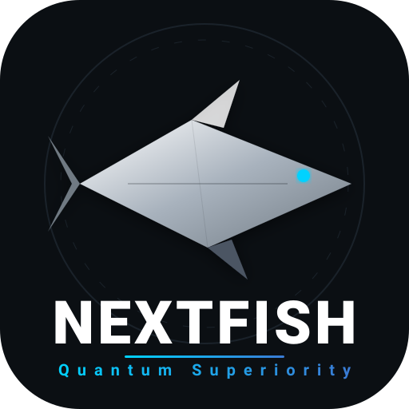

<div align="center">

  

  <h3>Nextfish HARENN V72</h3>

  A high-performance UCI chess engine powered by HARENN (Hybrid Adaptive Reduction Engine Neural Network).
  <br>
  <strong>A tactical time-management evolution of Stockfish 18.</strong>
  <br>
  <br>

  [![License][license-badge]][license-link]
  [![Base][base-badge]]
  [![Version][version-badge]](#)

</div>

## Overview

**Nextfish HARENN** is an advanced chess engine derived from **Stockfish 18**, specifically engineered to bridge the gap between classical search algorithms and modern neural intuition.

The core of Nextfish is the **HARENN (Hybrid Adaptive Reduction Engine Neural Network)** system, which utilizes a multi-head neural network trained on over 770,000 tactical positions. The V72 "Dynamic Time Orchestrator" release manages Search time allocation through three AI-predicted parameters: **Tau** (Tactical Complexity), **Rho** (Horizon Risk), and **Rs** (Move Difficulty/Resolution Score).

---

## HARENN V72 Architecture: Dynamic Time Orchestration

Instead of modifying Stockfish's highly optimized search reductions (LMR) and aspiration windows—which often introduces instabilities at long time controls—Nextfish V72 preserves **100% search loop integrity** and focuses exclusively on **intelligent time allocation**.

### Key Improvements in V72:
*   **Normalized Heads:** Individual neural network heads (`tau`, `rho`, and `rs`) are normalized based on their actual empirical distributions over opening books.
*   **Maximum-based Complexity:** Due to a strong negative correlation (`-0.77`) between Tactical Complexity and Horizon Risk, adding them directly causes cancellation. V72 resolves this by taking the maximum of the normalized components: `max(comp_norm, crit_norm, diff_norm)`.
*   **Gridded Time Scaling:**
    *   **Quiet/Simple Positions:** Scales time down to **80%** to build a time buffer.
    *   **Standard Positions:** Scales time around **100-110%**.
    *   **Complex/Critical Positions:** Scales time up to **150%** to search deeper where blunders are likely.
    *   **Game average:** Stays at a sustainable **~118%**, avoiding time trouble while providing critical depth boosts.

---

## Performance Benchmark

> **The Elo figures that were published in this section before are retracted.**
> They come from very small matches (20-40 games, no SPRT) and one of them compared a
> **non-PGO build against a PGO baseline**. A cross-build comparison like that is invalid:
> the "speed penalty" of a non-PGO build was never measured inside the same match as the
> claimed gain, so the derived "+217 Elo relative improvement" has no meaning.
> The numbers are kept below only as a record of what was claimed, marked as unverified.

### Previously published numbers (UNVERIFIED / RETRACTED)

| Engine | Wins | Losses | Draws | Elo Diff | LOS | Status |
| :--- | :---: | :---: | :---: | :---: | :---: | :--- |
| **Nextfish V72 (PGO)** vs Stockfish 18 (PGO), `10s+0.1`, 40 games | 13 | 11 | 16 | +17.4 | 65.8% | Unverified, retracted |
| **Nextfish V72 (non-PGO)** vs Stockfish 18 (PGO), `2s+0.1`, 20 games | 6 | 2 | 2 | +147.2 | 92.1% | Invalid (cross-build), retracted |

### Sanity check performed with the bug fixes

The following numbers were produced with `run_match.py` at a **fixed 100 ms per move**,
single threaded, against the official Stockfish 18 `sf_18` build. They are **not** a
benchmark, they only show that the bug fixes did not cost strength. With 40 to 60 games
the error bar is roughly +/-60 Elo, so only differences of that size mean anything.

| Build | Opponent | Result | Score | Elo |
| :--- | :--- | :---: | :---: | :---: |
| Nextfish, revision `fa0d737` (before the fixes) | Stockfish 18 | 19W - 11L - 10D (40 games) | 60.0% | +70.4 +/- 56 |
| Nextfish, with the fixes | Stockfish 18 | 24W - 15L - 21D (60 games) | 57.5% | +52.5 +/- 45 |

The two results agree within their error bars, so the fixes did not cost strength. They do
remove a wrong piece encoding that read past the end of the weight matrix, a search
extension that could no longer decrease the depth, and a build that did not compile
without AVX2.

Reproduce with:

```bash
python3 run_match.py --engine src/stockfish \
                     --engine2 /path/to/stockfish-ubuntu-x86-64-avx2 \
                     --book temp/book_fens.json --games 60 --movetime 100
```

### What a valid benchmark looks like

A result may only be published if it was produced by the protocol below, on **both** sides
with the **same build type** (PGO vs non-PGO) and the **same compiler settings**:

*   **Time control:** `10+0.1` (10 s + 0.1 s increment), 1 thread, 512 MB hash.
*   **Games:** 500 games (each opening of the UHO 2022 book played with both colors).
*   **Opening book:** `UHO_2022_8mvs_+110_+119.pgn`.
*   **Adjudication:** `-resign movecount=3 score=400`, `-draw movenumber=40 movecount=8 score=20`.
*   **Statistics:** real SPRT, `elo0=0`, `elo1=5`, `alpha=0.05`, `beta=0.05` (normalized Elo model).
*   **Reproduction:** the `.github/workflows/auto-solo-vs-stockfish.yml` workflow runs exactly
    this protocol and writes the score/Elo lines to the job summary and to
    `matches/summary.txt`; `config.json` holds the same protocol for fastchess.

Until such a run exists, **no Elo claim for Nextfish is published in this README**.
Cross-build comparisons (PGO against non-PGO, or a different compiler/architecture on one
side only) are never valid and must not be reported.

---

## UCI Options

Nextfish adds the following UCI options on top of the Stockfish 18 option set. The table
lists every HARENN/DEE option that is currently declared in `src/engine.cpp`, with its
type, default value and valid range.

| Option | Type | Default | Range | Description |
| :--- | :---: | :---: | :---: | :--- |
| **Use DEE/HARENN** | check | `true` | - | Master switch for the HARENN network and the HARENN time manager. When disabled the engine plays like plain Stockfish 18. |
| **Use DEE Capture Ordering** | check | `true` | - | Use the DEE adjusted static exchange evaluation to order captures in move picking. |
| **Use DEE Capture Pruning** | check | `false` | - | Allow DEE to prune captures whose adjusted SEE is clearly losing. Off by default. |
| **Use DEE Capture LMR** | check | `false` | - | Apply the DEE capture information to the late move reduction table. Off by default. |
| **Use HARE Time Management** | check | `true` | - | Enable the HARENN dynamic time multiplier (the Tau/Rho/Rs driven time orchestration). |
| **HARE TM Center** | spin | `35` | 20 - 50 | Center of the tactical-complexity time scaling, in hundredths (35 = 0.35). |
| **HARE TM Slope** | spin | `143` | 50 - 300 | Slope of the time scaling curve, in tenths (143 = 14.3). |
| **HARE TM Range Min** | spin | `95` | 85 - 100 | Lower bound of the time scaling range, in percent (95 = 0.95x). |
| **HARE TM Range Max** | spin | `105` | 100 - 115 | Upper bound of the time scaling range, in percent (105 = 1.05x). |
| **HARE Ext Threshold White** | spin | `823` | 500 - 950 | Horizon-risk threshold above which a position is extended, for White, in thousandths (823 = 0.823). |
| **HARE Ext Threshold Black** | spin | `706` | 500 - 950 | Horizon-risk threshold above which a position is extended, for Black, in thousandths (706 = 0.706). |
| **Contempt** | spin | `8` | 0 - 50 | Contempt factor used for the aspiration window and the optimism score. |

The extension is granted when the HARENN model reports a high horizon risk (`rho`) **or** a
low resolution score (`rs`). The number of extensions granted along a single principal
variation is capped, so a chain of consecutive checks cannot keep the search depth
constant for the whole line.

> **The extension thresholds need to be re-tuned for the current model.**
> Measured over 5000 positions of the training corpus, the model reports
> `rho` in the range 0.46 .. 0.70 and `rs` in the range 0.19 .. 0.97. The default
> threshold of 0.823 (White) and 0.706 (Black) is therefore **never reached by `rho`**,
> so in practice only the `rs` part of the condition can fire. Requiring both
> conditions would disable the extension completely. The thresholds were fitted to an
> older model; re-tune them with `spsa_tune.py` before drawing any conclusion from the
> strength of the extension.

### Model and network file locations

*   The HARENN model file **`nextfish.harenn`** is resolved **relative to the directory of
    the engine executable**, and only as a fallback relative to the current working
    directory. The model therefore has to be placed **next to the binary**
    (for example `builds/nextfish_built.exe` and `builds/nextfish.harenn`). A copy that
    only exists somewhere else is not found and the engine continues without HARENN.
*   The NNUE evaluation nets (`nn-c288c895ea92.nnue`, `nn-37f18f62d772.nnue`) are resolved
    relative to the executable directory as well and belong next to the binary.
*   The tracked model lives in `src/nextfish.harenn`; copy it next to the built engine
    before running it.

### Verifying the incremental threat accumulator

The threat feature set updates its accumulator incrementally after every move. Setting the
environment variable `NEXTFISH_FULL_REFRESH=1` forces the accumulator to be recomputed from
scratch instead. Both modes have to produce the same search result, so the benchmark output
of the two runs must be identical apart from the timing lines:

```bash
cd src
./stockfish bench 2>&1 | sed -E 's/ (nps|time) [0-9]+//g' > /tmp/inc.txt
NEXTFISH_FULL_REFRESH=1 ./stockfish bench 2>&1 | sed -E 's/ (nps|time) [0-9]+//g' > /tmp/full.txt
diff /tmp/inc.txt /tmp/full.txt
```

A difference means that an incremental update does not reproduce the value of a full
refresh and has to be fixed.

---

## Compiling Nextfish

Nextfish is built from the `src/` directory. The build produces a binary called `stockfish`
(`stockfish.exe` on Windows); the CI renames it to `nextfish_built.exe`.

The NNUE nets are fetched by `make net` (which runs `scripts/net.sh`) when they are missing
from `src/`; the two required files are the ones referenced in `src/evaluate.h`
(`nn-c288c895ea92.nnue` and `nn-37f18f62d772.nnue`).

### Linux

```bash
cd src
make -j"$(nproc)" profile-build ARCH=x86-64-avx2     # PGO build (recommended)
# portable build for older CPUs:
make -j"$(nproc)" profile-build ARCH=x86-64

# put the engine and the HARENN model next to each other
mkdir -p ../builds
cp stockfish ../builds/nextfish_built
cp nextfish.harenn ../builds/
cp nn-*.nnue ../builds/
```

### macOS

```bash
cd src
make -j"$(sysctl -n hw.ncpu)" profile-build ARCH=x86-64-vnni256   # Intel
make -j"$(sysctl -n hw.ncpu)" profile-build ARCH=armv8             # Apple Silicon

mkdir -p ../builds
cp stockfish ../builds/nextfish_built
cp nextfish.harenn ../builds/
cp nn-*.nnue ../builds/
```

### Windows (MSYS2 / MinGW)

The PGO recipes in `src/Makefile` are POSIX shell scripts, so the build has to run in a
POSIX shell (MSYS2 or Cygwin) - **not** in `cmd.exe`.

```bash
# MSYS2 MINGW64 shell
cd src
make -j4 profile-build ARCH=x86-64-avx2 COMP=mingw

# non-PGO build
make -j4 build ARCH=x86-64-avx2 COMP=mingw
```

After the build, place the executable and the HARENN model in the same directory, e.g.
`builds/nextfish_built.exe` and `builds/nextfish.harenn`.

---

## License

Nextfish is free and distributed under the **GNU General Public License version 3** (GPL v3). As a derivative of Stockfish, all modifications are open-source and contribute back to the community.

---

[license-link]: https://github.com/AustraliaSilver/nextfish/blob/master/Copying.txt
[license-badge]: https://img.shields.io/github/license/AustraliaSilver/nextfish?style=for-the-badge&label=license&color=success
[base-badge]: https://img.shields.io/badge/Base-Stockfish_18-blue?style=for-the-badge
[version-badge]: https://img.shields.io/badge/Version-HARENN_V72_LTC-blue?style=for-the-badge
